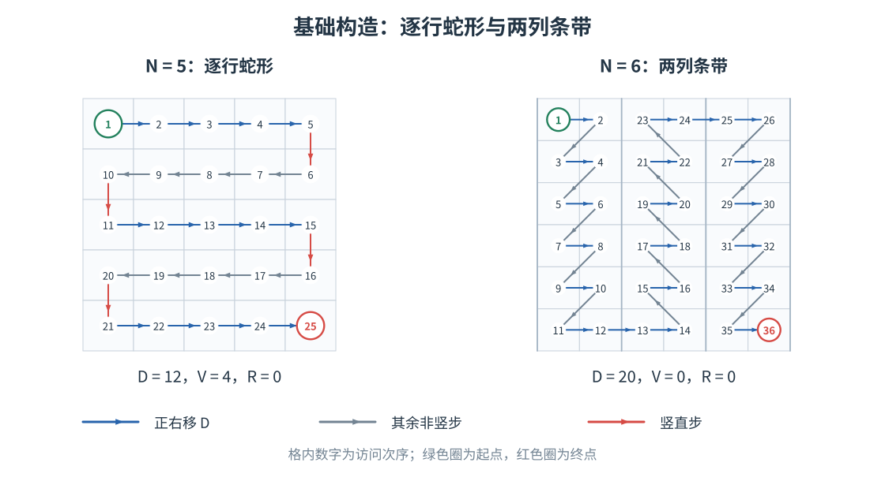
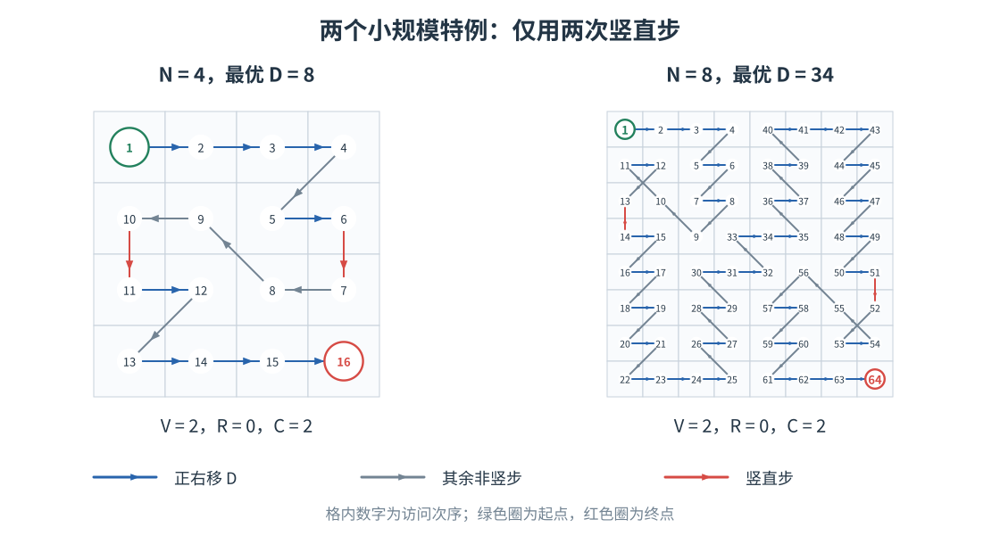
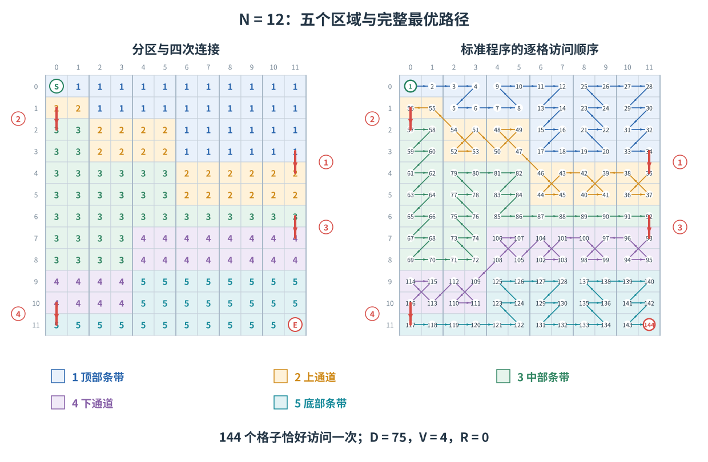

# 上下左右 题解

这是一道构造题：先确定最多能走多少次 `D`，再按 $N$ 的类型输出一条达到它的路径。下面先讲怎么构造，最优性的证明放在最后。

为便于对应代码，本文的行列坐标统一从 $0$ 开始，起点为 $(0,0)$，终点为 $(N-1,N-1)$。**允许斜边相交，只要求格子不被重复访问。**

## 1. 把目标变成“少走特殊步”

记 $D$ 为正右步数，$R$ 为右上、右下步数之和，$L$ 为向左的三种步数之和，$V$ 为竖直步数。总步数与横向位移给出

$$D+R+L+V=N^2-1,\qquad D+R-L=N-1.$$

所以

$$D=\frac{N^2+N-2-C}{2},\qquad C=V+2R.$$

因此，应尽量不用右斜步，再减少竖直步。最终有四种情况：

| $N$ 的类型 | 构造方式 | 最优 $D$ |
| --- | --- | --- |
| 奇数 | 逐行蛇形 | $(N^2-1)/2$ |
| $N\equiv2\pmod4$ | 两列条带蛇形 | $(N^2+N-2)/2$ |
| $N=4,8$ | 固定小构造 | $(N^2+N-4)/2$ |
| $N\equiv0\pmod4$ 且 $N\ge12$ | 五阶段构造 | $(N^2+N-6)/2$ |

## 2. 构造方法

### 2.1 奇数：逐行蛇形

第 $0$ 行从左到右，第 $1$ 行从右到左，交替走到最后一行；相邻行之间向下走一步。

奇数行数保证最后停在右下角。共有 $(N+1)/2$ 行从左往右，每行贡献 $N-1$ 次 `D`，总计 $(N^2-1)/2$ 次。

### 2.2 模 $4$ 余 $2$：两列一组

将列分为 $m=N/2$ 个条带，第 $j$ 个条带包含第 $2j,2j+1$ 列。每到一行，都先访问左格，再访问右格；然后用左上或左下走到下一行的左格。

- 偶数编号条带从上往下，奇数编号条带从下往上。
- 一条带走完后，用一次 `D` 进入下一条带。

$m$ 为奇数，所以最后一条带向下走，恰好在右下角结束。条带内有 $mN$ 次 `D`，条带间还有 $m-1$ 次，总计 $(N^2+N-2)/2$ 次。$N=2$ 也直接使用这个做法。

{width=95%}

### 2.3 两个特例：$N=4,8$

当条带数为偶数时，上面的走法会停在右上角。$N=4,8$ 可以各存一条固定路径，只用两次竖直步：

```text
N=4: DDDZDXAQAXDZDDD
N=8: DDDZDZDZQQDZXDZDZDZDZDDDQDQDQDDQDDQDQDQDDDZDZDZDZDXZDQQZDZDZDDD
```

{width=95%}

### 2.4 其余四的倍数：五个阶段、四次竖步

以下处理 $N\ge12$、$N\equiv0\pmod4$。仍然将网格分为 $m=N/2$ 个两列条带，但把路径拆成五段：

$$\text{顶部条带}\to\text{上通道}\to\text{中部条带}\to\text{下通道}\to\text{底部条带}.$$

三个“条带段”从左到右访问各条带；两个“通道段”从右到左返回。五段之间各用一次向下移动衔接，其余只用 `D` 或向左的三个方向。

{width=100%}

**先准备两个小工具。** 记第 $j$ 个条带第 $h$ 行的左右两格为

$$L_j(h)=(h,2j),\qquad R_j(h)=(h,2j+1).$$

`stripe(j,lo,hi,down)` 用来扫描这个条带的连续行：若 `down=true`，行号从 `lo` 增加到 `hi`，否则反过来；每行均依次加入 $L_j(h),R_j(h)$。

另一个工具是“折返模块”。给每条带指定 $d_j\in\{-1,1\}$，定义

$$F(j,h):\quad R_j(h)\to L_j(h+d_j)\to R_j(h+d_j)\to L_j(h).$$

它占据相邻两行，从右格进入、从左格离开。$d_j=-1$ 时方向串为 `QDZ`，$d_j=1$ 时为 `ZDQ`。模块内部没有竖直步，也没有右斜步。

{width=95%}

**然后划分每个条带的五个区域。** 对 $j=0,\ldots,m-1$，计算

$$a_j=\min(j+1,m-2),\qquad b_j=\max(N-2-j,m+1),$$

$$d_j=\begin{cases}-1,&j\text{ 为偶数且 }j<m-3,\\1,&\text{其他}.
\end{cases}$$

上通道使用第 $a_j$ 行和它的折返邻行；下通道使用第 $b_j$ 行和它的折返邻行。**上通道的 $j=0$ 是唯一例外：只走 $R_0(a_0)\to L_0(a_0)$，不使用邻行。**

为避免条带段走进通道，设 $[P]$ 在条件 $P$ 成立时为 $1$，否则为 $0$，并计算四个端点：

$$\begin{aligned}
t_j&=a_j-1-[j>0\land d_j=-1],\\
u_j&=a_j+1+[j>0\land d_j=1],\\
v_j&=b_j-1-[d_j=-1],\\
w_j&=b_j+1+[d_j=1].
\end{aligned}$$

接下来按下表顺序向答案中追加格子即可。扫描一个条带时，“向下”指行号递增。

| 阶段 | 条带枚举顺序 | 追加内容 |
| --- | --- | --- |
| 1 顶部 | $j=0\to m-1$ | 扫描 $[0,t_j]$，$j$ 为奇数时向下 |
| 2 上通道 | $j=m-1\to0$ | $j>0$ 时追加 $F(j,a_j)$；$j=0$ 时只追加该行右格、左格 |
| 3 中部 | $j=0\to m-1$ | 扫描 $[u_j,v_j]$，$j$ 为偶数时向下 |
| 4 下通道 | $j=m-1\to0$ | 追加 $F(j,b_j)$ |
| 5 底部 | $j=0\to m-1$ | 扫描 $[w_j,N-1]$，$j$ 为奇数时向下 |

这些式子只是把“通道占用的行”从普通条带扫描中扣掉。例如 $d_j=1$ 时，上通道占用 $a_j,a_j+1$，所以中部从 $a_j+2$ 开始；$d_j=-1$ 时，则将顶部的末行减一。

**以 $N=12$ 为例：**

$$\begin{aligned}
(a_0,\ldots,a_5)&=(1,2,3,4,4,4),\\
(b_0,\ldots,b_5)&=(10,9,8,7,7,7),\\
(d_0,\ldots,d_5)&=(-1,1,-1,1,1,1).
\end{aligned}$$

{width=100%}

实现时，**五段依次加入同一个坐标数组即可，不用额外插入连接格子**。前一段的末格和后一段的首格已经相邻；重复加入端点反而会访问同一格两次。

四次连接的位置固定为：

| 连接 | 前一格 | 后一格 |
| --- | --- | --- |
| 顶部到上通道 | $(m-3,N-1)$ | $(m-2,N-1)$ |
| 上通道到中部 | $(1,0)$ | $(2,0)$ |
| 中部到下通道 | $(m,N-1)$ | $(m+1,N-1)$ |
| 下通道到底部 | $(N-2,0)$ | $(N-1,0)$ |

所以恰好有四次 `X`，没有其他竖直步或右斜步，得到 $C=4$。

## 3. 输出与复杂度

按照上述分支得到格子序列 $p_0,p_1,\ldots,p_{N^2-1}$。对相邻两格求行列差 $(\Delta r,\Delta c)$，用下表转成方向字符：

```text
Q W E
A ? D
Z X C
```

表中行号为 $\Delta r+1$、列号为 $\Delta c+1$；`?` 不会被使用。每组先输出最优值，再输出方向串。

每格只加入一次，时间、空间均为 $O(N^2)$，与输出规模相同。正解对应 `std_maximum.cpp`。

## 4. 部分分路线

- **累计 10 分，$N\le3$：** DFS 枚举路径，记录遍历全部格子并到达右下角时最大的 `D` 数。
- **累计 25 分，$N\le4$：** 子集 DP，状态为“访问集合、最后一格”，保存最大 `D` 数并恢复路径。
- **累计 45 分：** 加上奇数的逐行蛇形。
- **累计 65 分：** 加上 $N\equiv2\pmod4$ 的两列条带。
- **100 分：** 加上 $N=8$ 特例和其余四的倍数的五阶段构造。

子集 DP 的时间、空间为 $O(2^{N^2}N^2)$。$N=4$ 也可直接使用上面的固定构造。

## 5. 为什么达到最优

**奇数。** 按列号奇偶染色，两种颜色的格子数相差 $N$，起终点都属于较多的颜色。要把这些格子串成一条路径，至少有 $N-1$ 次相邻格子同色；只有竖直步保持列颜色，因此 $V\ge N-1$。代入计数式得到 $D\le(N^2-1)/2$，逐行蛇形达到等号。

**模 $4$ 余 $2$。** 显然 $C\ge0$，两列条带构造直接达到 $C=0$。

**四的倍数。** $C$ 必为偶数。若 $C=0$，只允许 `D` 以及向左的三种步。第一列每格的出边都被强制为 `D`；将这些同行的左右格缩成一对，可知第一条带必须从顶到底走完，再依次交替扫描其他条带。条带数为偶数时，这条强制路径停在右上角，因此 $C=0$ 不可能。

对于 $N=4,8$，上述固定构造达到 $C=2$，已经最优。对于 $N\ge12$，还需排除 $C=2$：

- 若 $V=0,R=1$，两列条带内的右向边必须形成完美匹配，不能仅有一条右斜边；把它放在条带间，又会让下一条带从内部行进入，无法遍历所有行。
- 若 $V=2,R=0$，可由列切口计数确定一段连续的“活动条带”。每条活动条带恰有一行缺少内部 `D`，记为 $h_j$。相邻缺口必须相邻，即 $|h_{j+1}-h_j|\le1$。顶端和底端的边界状态约束进一步要求 $\min h_j\le2$、$\max h_j\ge N-3$，于是活动条带数至少为 $N-4$，但总条带数只有 $N/2$，推出 $N\le8$，矛盾。

因此 $N\ge12$ 时至少需要 $C=4$，而五阶段构造恰好达到它。上面第二种情况的完整切口推导和边界状态分析见附件 PDF “最优值证明”。

最后检查五阶段构造的合法性：两条通道占据的行先被预留，其余行恰好分给顶部、中部、底部三个连续段，所以没有遗漏或重复。条带段内部、相邻条带之间及通道内部的连接均为八邻接；五段之间的连接已在表中列出。首格为左上角，末格为右下角，因此确实得到一条合法最优路径。
