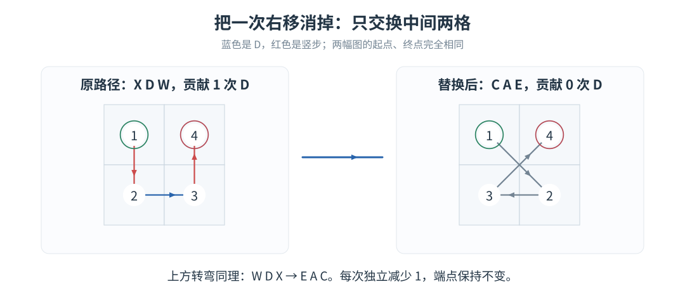
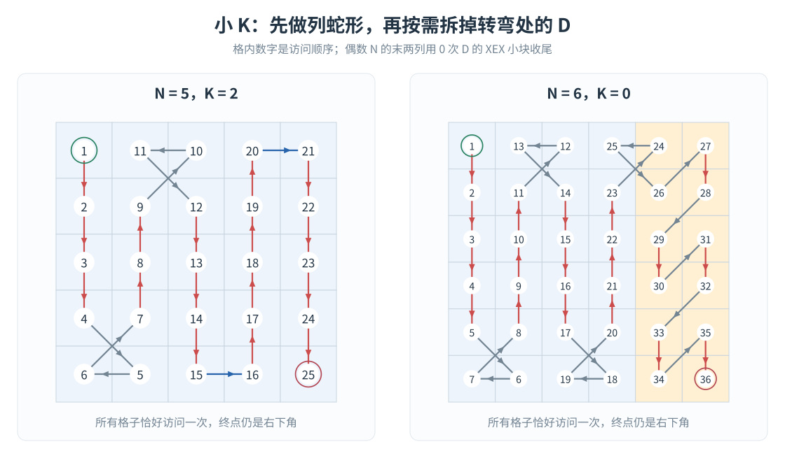
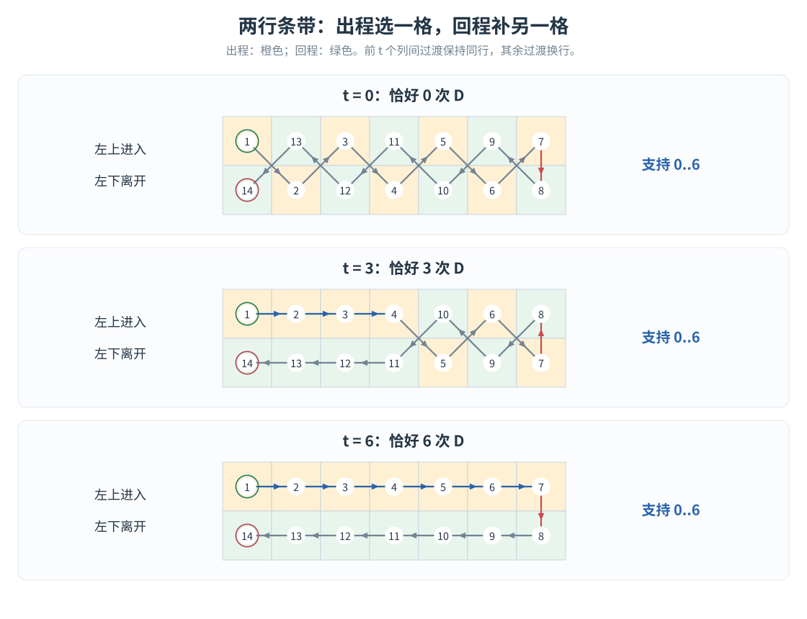
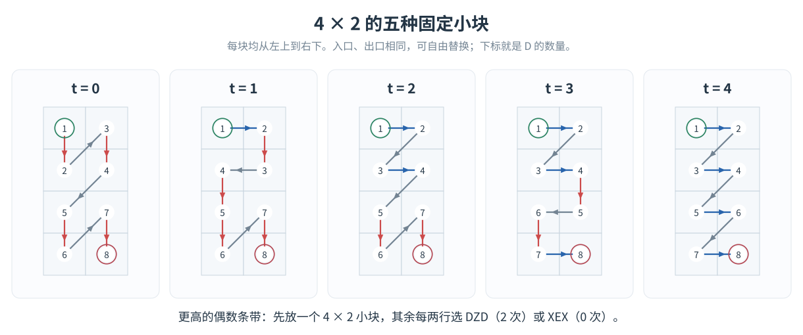
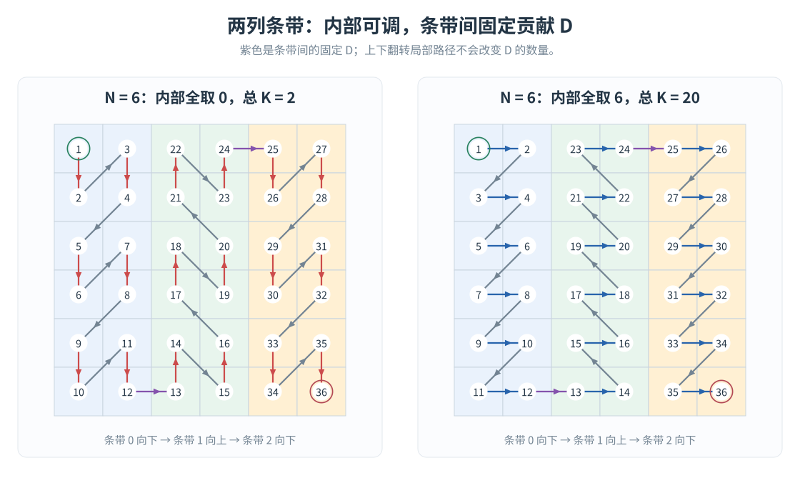
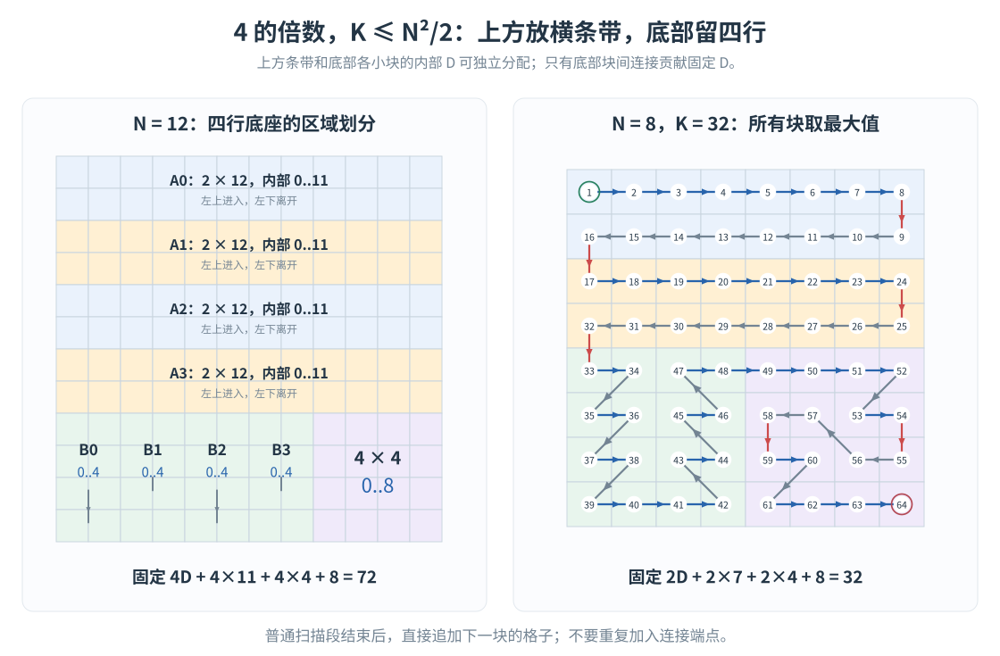
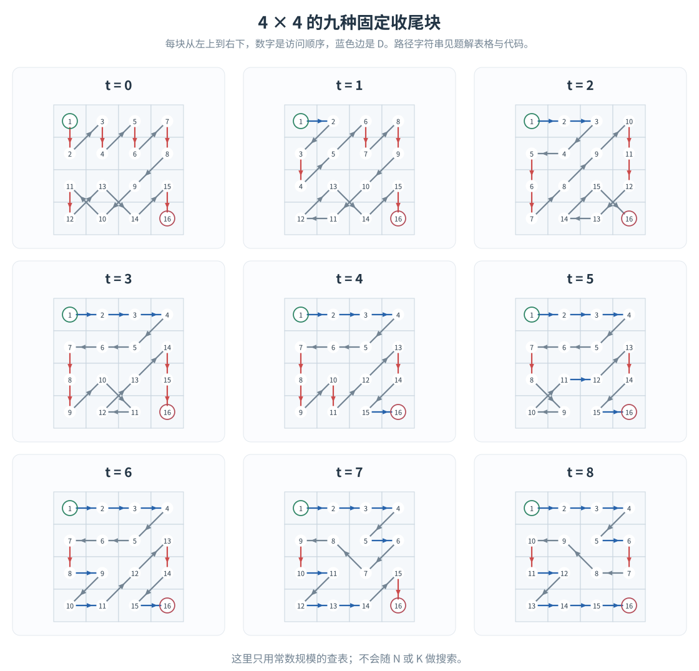
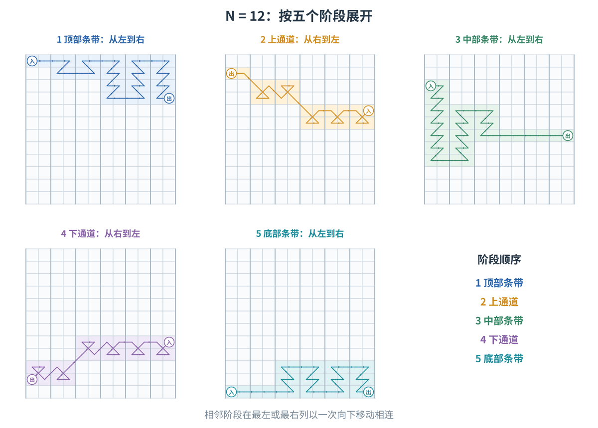
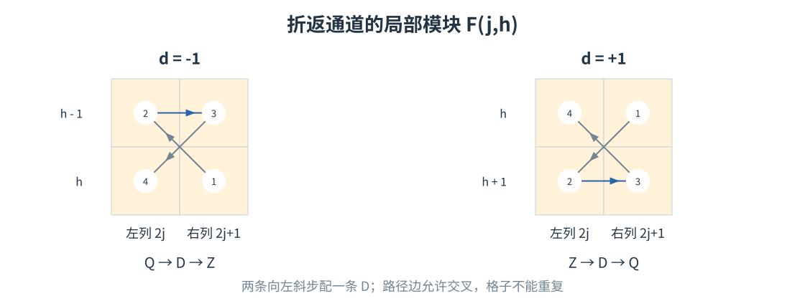
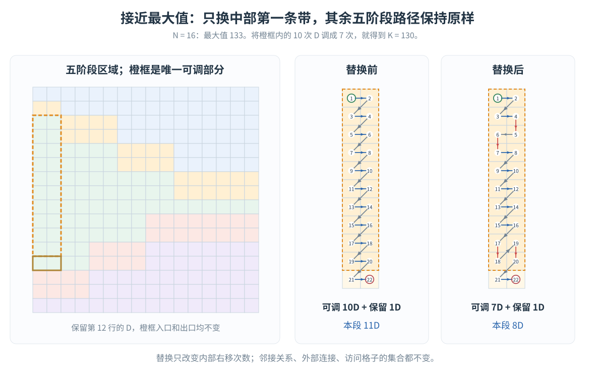

# LRUD Moving：指定右移次数的构造

给定 $N,K$，从左上角出发，恰好访问每个格子一次，最后停在右下角，并且恰好走 $K$ 次正右方向的 `D`。这里不再预设 $K\le\lfloor N^2/2\rfloor$，因此也要处理接近真正最大值的情况。

本文沿用 **LRUD Moving 4** 的最大值结论和五阶段路径，重点解释：**怎样在保持入口、出口不变的前提下，调节路径中的 `D` 数量。** 最大值的证明不再重复。

行列坐标均从 $0$ 开始。允许斜边相交；只要求格子不被重复访问。

## 1. 先判断是否有解

记 LRUD Moving 4 中求出的最大值为

$$
M(N)=
\begin{cases}
(N^2-1)/2,&N\text{ 为奇数},\\
(N^2+N-2)/2,&N\equiv2\pmod4,\\
(N^2+N-4)/2,&N=4\text{ 或 }8,\\
(N^2+N-6)/2,&N\equiv0\pmod4,\ N\ge12.
\end{cases}
$$

判定规则十分简单：

- $K<0$ 或 $K>M(N)$：无解。
- $N=2,K=1$：无解。
- 其他情况：都有解。

$N=2$ 只有两条合法路径：`XEX` 贡献 $0$ 次 `D`，`DZD` 贡献 $2$ 次 `D`。下面的构造会证明，**$N\ge3$ 时，$0,1,\ldots,M(N)$ 没有任何空缺。**

整个算法按下面的路线分支。区间有少量重叠，实现时按表中顺序选择即可。

| 情况 | 使用的构造 | 该构造支持的 $K$ |
| --- | --- | --- |
| 奇数 $N$，小 $K$ | 列蛇形，逐个拆掉转弯处的 `D` | $0\ldots N-1$ |
| 偶数 $N$，小 $K$ | 前 $N-2$ 列蛇形，末两列收尾 | $0\ldots N-2$ |
| 奇数 $N$，其他 $K$ | 两行一组，最后一行向右 | $N-1\ldots M(N)$ |
| $N\equiv2\pmod4$，其他 $K$ | 两列一组，上下交替 | $N/2-1\ldots M(N)$ |
| $N\equiv0\pmod4,\ K\le N^2/2$ | 上方两行条带，底部四行收尾 | $N/2-2\ldots N^2/2$ |
| $N\equiv0\pmod4,\ K>N^2/2$ | 五阶段最大路径，替换其中一小段 | 直到 $M(N)$ |

## 2. 小 $K$：从转弯处一次减掉一个 `D`

先看列蛇形的一个底部转弯：

$$
(r,c)\to(r+1,c)\to(r+1,c+1)\to(r,c+1).
$$

方向串为 `XDW`，恰好有一次 `D`。**交换中间两个格子的访问顺序**，就变成

$$
(r,c)\to(r+1,c+1)\to(r+1,c)\to(r,c+1),
$$

方向串为 `CAE`，不再包含 `D`。

{width=100%}

四个格子的集合没变，入口、出口也没变，因此路径的其余部分完全不用修改。顶部转弯同理：

$$
\texttt{WDX}\ \longrightarrow\ \texttt{EAC}.
$$

### 2.1 奇数 $N$

按列上下蛇形遍历，恰有 $N-1$ 个转弯，每个转弯贡献一个 `D`，最后到达右下角。

任意选择 $N-1-K$ 个转弯进行替换，就得到任意 $K\in[0,N-1]$。

### 2.2 偶数 $N$

只蛇形遍历前 $N-2$ 列。因为列数为偶数，此时停在 $(0,N-3)$。

最后两列每两行放一个 `XEX` 小块：

$$
(r,N-2)\to(r+1,N-2)\to(r,N-1)\to(r+1,N-1),
\quad r=0,2,\ldots,N-2.
$$

这些小块内部没有 `D`，块间连接也没有 `D`。加上进入最后两列的那一步，总共恰好有 $N-2$ 次 `D`。

进入最后两列的那次 `D` 也处在 `WDX` 中，可以同样拆掉。因此支持任意 $K\in[0,N-2]$。

{width=100%}

实现时先生成坐标数组，再扫描原路径中的 `D`；需要减少时交换这条边的两个端点。各转弯被交换的两格互不重合，相邻转弯即使共享格子，也只共享未移动的外端点，所以这些替换可以独立进行。

## 3. 两种可以调节次数的条带

后面的构造都用下面两个工具。**参数 $t$ 只统计块内部的 `D`，块间连接要另外计数。**

### 3.1 两行条带 $A_w(t)$：任意 $0\le t\le w-1$

在一个 $2\times w$ 矩形中，从左上进入，左下离开。

先从左往右，每列只访问一格；到最右列后竖直换到另一格，再从右往左访问各列剩下的格子。

回程始终向左，不会产生 `D`。出程中，相邻两列选同行就产生一个 `D`，选异行就产生一个右斜步。因此，只需让前 $t$ 次过渡保持同行，之后每次换行。

{width=100%}

设第 $c$ 列出程所选的相对行号为 $s_c\in\{0,1\}$。一种直接的实现是

$$
s_0=0,\qquad
s_c=s_{c-1}\mathbin{\mathrm{xor}}[c>t].
$$

依次加入 $(s_c,c)$，再倒序加入 $(1-s_c,c)$ 即可。入口、出口始终是左上、左下。

### 3.2 偶数高度的两列条带 $B_h(t)$：任意 $0\le t\le h$

要求 $h\ge4$ 且为偶数。从左上进入，右下离开。

一个 $2\times2$ 小块已经支持两种选择：

- `XEX`：贡献 $0$ 次 `D`；
- `DZD`：贡献 $2$ 次 `D`。

但只使用它们，无法调整奇偶性。因此，先预留一个 $4\times2$ 小块，它有以下五种固定路径：

| 内部 `D` 数 $t$ | 方向串 |
| --- | --- |
| 0 | `XEXZXEX` |
| 1 | `DXAXXEX` |
| 2 | `DZDZXEX` |
| 3 | `DZDXAXD` |
| 4 | `DZDZDZD` |

{width=100%}

其余 $h-4$ 行，每两行使用一个 `XEX` 或 `DZD`。相邻小块之间用左下一步连接，不增加 `D`。

给定目标 $t$，先选

$$
a=\min(t,4),
$$

若 $a$ 与 $t$ 奇偶性不同，就将 $a$ 减一。于是

$$
0\le a\le4,\qquad 0\le t-a\le h-4,\qquad t-a\text{ 为偶数}.
$$

首个 $4\times2$ 小块贡献 $a$，再让 $(t-a)/2$ 个 $2\times2$ 小块贡献 $2$，其余贡献 $0$，便得到任意 $t\in[0,h]$。

**上下翻转整个条带不会改变 `D` 数量。** 翻转后，从左下进入、右上离开；后面会交替使用这两个方向。

## 4. 奇数与模 4 余 2：直接把次数分配给条带

### 4.1 奇数 $N$

将前 $N-1$ 行分成 $(N-1)/2$ 个两行条带 $A_N(t)$。每条带从左上到左下，条带之间竖直向下衔接，不增加 `D`。

最后一行从左往右，固定贡献 $N-1$ 次 `D`。

因此，只需将

$$
K-(N-1)
$$

分配给前面的条带，每条带的容量为 $N-1$。总容量恰好是

$$
(N-1)+\frac{N-1}{2}(N-1)=\frac{N^2-1}{2}=M(N).
$$

所以支持整个 $[N-1,M(N)]$。结合小 $K$ 构造，奇数的所有可行取值均被覆盖。

### 4.2 $N\equiv2\pmod4$

将列分成 $m=N/2$ 个条带 $B_N(t)$，偶数编号向下，奇数编号向上。

因为 $m$ 为奇数，最后恰好在右下角结束。相邻条带之间固定走一次 `D`，共有 $m-1$ 次。

{width=100%}

只需把 $K-(m-1)$ 分配给 $m$ 个条带，每个容量为 $N$，就覆盖

$$
m-1\le K\le mN+m-1=M(N).
$$

小 $K$ 构造覆盖到 $N-2$，两个区间之间没有空缺。

**分配不需要背包。** 每个模块都支持从 $0$ 到容量的所有整数，因此依次取 $t=\min(\text{剩余次数},\text{容量})$ 即可。这里的“容量”指最多能放入多少次 `D`。

## 5. 四的倍数、普通 $K$：底部留一个四行底座

以下 $4\mid N$，先处理 $K\le N^2/2$。设

$$
q=\frac{N-4}{2}.
$$

将整个网格划分为：

1. 上方 $N-4$ 行：分成 $q$ 个两行条带 $A_N(t)$；
2. 底部四行的前 $N-4$ 列：分成 $q$ 个高度为 4 的两列条带 $B_4(t)$，上下交替；
3. 右下角：一个 $4\times4$ 收尾块。

$q$ 为偶数，所以底部两列条带走完后，停在底座的顶行，可以向右进入最后的 $4\times4$ 小块。

{width=100%}

收尾块从左上到右下，可以贡献任意 $0\ldots8$ 次 `D`。这只是一个常数大小的表，九条路径如下图所示；代码直接保存对应方向串，不进行搜索。

{width=100%}

上方条带之间，以及上方向底座的连接，都是向下走，不增加 `D`。底座内部，$q$ 个两列条带与最后的收尾块之间，固定贡献 $q$ 次 `D`。

所以将 $K-q$ 依次分配给各块即可。总的最大值恰为

$$
\underbrace{q}_{\text{固定连接}}
+\underbrace{q(N-1)}_{\text{上方横条带}}
+\underbrace{4q}_{\text{底座竖条带}}
+\underbrace{8}_{\text{收尾块}}
=\frac{N^2}{2}.
$$

所有块都支持连续的整数区间，因此覆盖整个 $[q,N^2/2]$。小 $K$ 构造覆盖 $[0,N-2]$，且 $q\le N-2$，所以区间衔接完整。

$N=4$ 时 $q=0$，整个网格就是一个收尾块，也自然包含在这个分支中。

## 6. 超过 $N^2/2$：从最大路径中只换一段

对于四的倍数，普通构造停在 $N^2/2$。剩下的取值数量只有 $O(N)$，没有必要重新设计整个网格：**从最大路径出发，把多出来的 `D` 从一条长条带里扣掉。**

### 6.1 先处理 $N=8$

$N=8$ 只剩 $K=33,34$ 两个值。直接保存两条固定路径即可：

```text
K=33:
DDDZDDDQDDDZDXZDQAZDQAZDQQAXDZDZDDDDDDDXZDQAZDQAZDQZQDZXDDDDDDD

K=34:
DDDZDZDZQQDZXDZDZDZDZDDDQDQDQDDQDDQDQDQDDDZDZDZDZDXZDQQZDZDZDDD
```

$N=4$ 没有超过 $N^2/2$ 的可行值，不需要进入本节。

### 6.2 $N\ge12$：沿用 LRUD Moving 4 的五阶段路径

设 $m=N/2$，将列分为 $m$ 个两列条带。最大路径依次访问：

$$
\text{顶部条带}\to\text{上通道}\to
\text{中部条带}\to\text{下通道}\to\text{底部条带}.
$$

三个条带段从左到右访问，两个通道段从右到左返回。五段之间恰有四次竖步，其余连接不含右斜步。

{width=100%}

为方便独立实现，这里保留五阶段的区域划分。记

$$
L_j(h)=(h,2j),\qquad R_j(h)=(h,2j+1),
$$

$$
a_j=\min(j+1,m-2),\qquad b_j=\max(N-2-j,m+1),
$$

$$
d_j=
\begin{cases}
-1,&j\text{ 为偶数且 }j<m-3,\\
1,&\text{其他}.
\end{cases}
$$

通道中的折返模块为

$$
F(j,h):\quad
R_j(h)\to L_j(h+d_j)\to R_j(h+d_j)\to L_j(h).
$$

{width=95%}

用 $[P]$ 表示条件 $P$ 成立时为 $1$，否则为 $0$。按下表顺序追加格子；普通扫描每行均先访问左格、再访问右格。

| 阶段 | 条带顺序 | 访问的行或模块 | 普通扫描的方向 |
| --- | --- | --- | --- |
| 顶部 | $j=0\to m-1$ | $0\ldots a_j-1-[j>0\land d_j=-1]$ | 奇数 $j$ 向下，偶数 $j$ 向上 |
| 上通道 | $j=m-1\to0$ | $j>0$ 用 $F(j,a_j)$；$j=0$ 只走 $R_0(a_0),L_0(a_0)$ | — |
| 中部 | $j=0\to m-1$ | $a_j+1+[j>0\land d_j=1]\ldots b_j-1-[d_j=-1]$ | 偶数 $j$ 向下，奇数 $j$ 向上 |
| 下通道 | $j=m-1\to0$ | $F(j,b_j)$ | — |
| 底部 | $j=0\to m-1$ | $b_j+1+[d_j=1]\ldots N-1$ | 奇数 $j$ 向下，偶数 $j$ 向上 |

这些公式只是将通道占用的行预留出来。五个区域互不重叠，恰好覆盖全部格子；相邻段的首尾格本来就相邻，不能重复加入连接端点。

这条路径有 $M(N)$ 次 `D`。接下来只改其中一个矩形。

### 6.3 唯一需要改动的位置

目标比最大值少

$$
\delta=M(N)-K
$$

次 `D`。

观察中部的第 $0$ 个条带：它从第 $2$ 行向下扫描到第 $N-4$ 行，总共 $N-5$ 行，每行原本贡献一次 `D`。

保留最后一行，即第 $N-4$ 行的两个格子不动。其上方剩下

$$
H=N-6
$$

行，是一个偶数高度的两列矩形，入口为 $(2,0)$，出口为 $(N-5,1)$。**这正是第 3.2 节已经解决的 $B_H(t)$！**

因此，把这一段从“贡献 $H$ 次 `D`”替换成“贡献 $H-\delta$ 次 `D`”，整个答案就恰好从 $M(N)$ 变成 $K$。

{width=100%}

替换一定合法，因为本分支中

$$
\frac{N^2}{2}<K\le M(N)=\frac{N^2}{2}+\frac N2-3,
$$

所以

$$
0\le\delta\le\frac N2-4,\qquad
0\le H-\delta\le H.
$$

新旧两段使用完全相同的格子，入口、出口也完全相同。外部连接保持原样，因此不会出现遗漏、重复或不相邻。

**高 $K$ 的新增操作就这一处。** 五阶段路径本身不用随着 $K$ 改变区域划分。

## 7. 正确性与复杂度

最大值结论给出了 $K>M(N)$ 的无解判定；$N=2$ 的唯一空缺单独处理。对剩下的输入：

- 小 $K$ 由转弯替换逐次减少 `D`；
- 奇数和模 4 余 2 的情况，把次数分配给支持连续区间的条带；
- 四的倍数在 $N^2/2$ 以下，用横条带和四行底座覆盖；
- 超过 $N^2/2$ 时，固定小例子或五阶段局部替换覆盖剩下全部取值。

每个模块都访问它负责的所有格子恰好一次，模块之间的端点相邻，整个路径从左上到右下。各部分的 `D` 已分别计数，因此构造满足所有要求，也证明了第 1 节的判定没有遗漏任何可行输入。

每格只加入、扫描常数次，时间、空间均为 $O(N^2)$，与输出规模一致。

## 8. 实现对应关系

完整 C++17 代码为 [std_any.cpp](std_any.cpp)。输入、输出沿用判定构造题的格式：

```text
输入：
T
N K
N K
...

输出：
No

或者：
Yes
长度恰为 N²-1 的方向串
```

注意这是**输入目标 $K$** 的程序，与 LRUD Moving 4 中“输出最大 $K$”的程序不同。

代码函数与题解的对应关系如下：

| 函数 | 作用 |
| --- | --- |
| `smallK` | 列蛇形及转弯替换 |
| `twoRows` | 两行条带 $A_N(t)$ |
| `evenColumns` | 偶数高度两列条带 $B_h(t)$ |
| `ordinaryMultiple4` | 横条带加四行底座 |
| `fiveStages` | 五阶段路径，扣掉 `delta` 次 `D` |
| `pattern` | 追加固定小块，可上下翻转 |
| `answer` | 将坐标序列转成方向字符 |

实现时最容易混淆两件事：

1. **先扣固定连接的 `D`，再分配块内部次数。** 例如两列条带蛇形先扣 $N/2-1$，四行底座先扣 $q$。
2. **模块的坐标集合互不重叠，不额外复制连接点。** `pattern` 会加入它的起点，调用者不再手工加入同一个点。

方向字符由相邻坐标差查表：

```text
Q W E
A ? D
Z X C
```

其中行下标为 $\Delta r+1$，列下标为 $\Delta c+1$。合法路径中不会取到 `?`。

